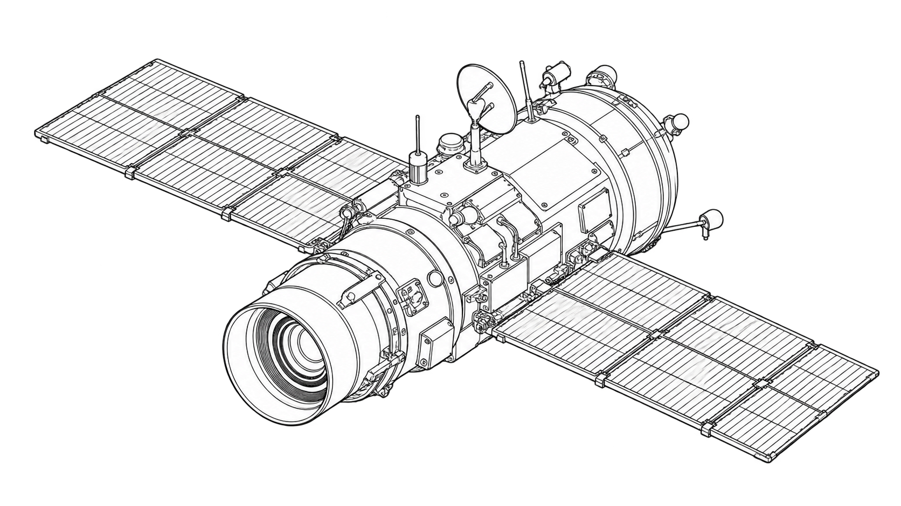
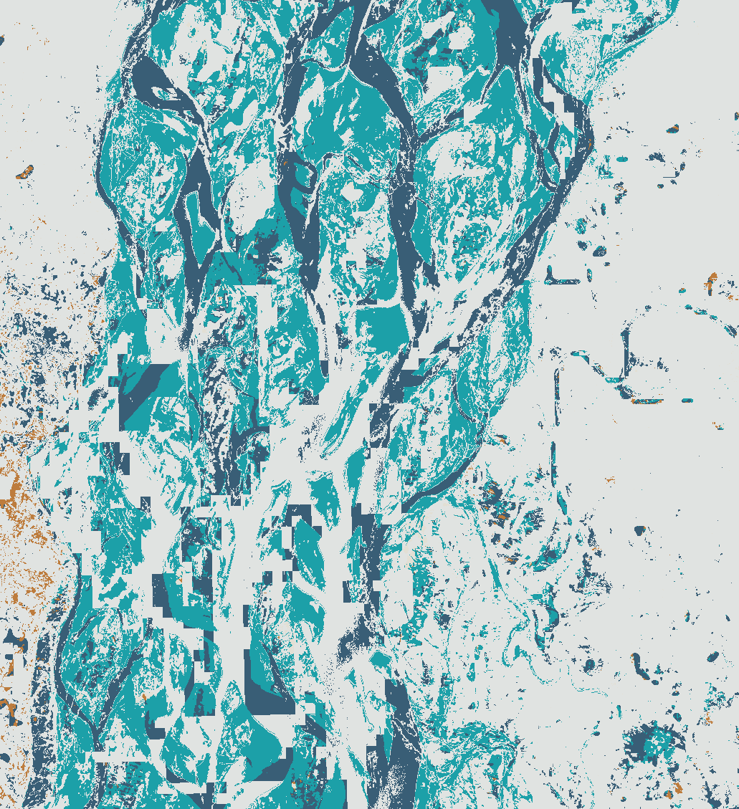

# Satellite-based Disaster Monitoring



*Generated line-art concept illustration. The maps below use real satellite measurements.*

A runnable historical Sentinel-2 water-change study, with a local geospatial viewer. Compare actual images, change the water-index threshold, inspect grid coordinates, and export a classified GeoTIFF. The default demo needs no account, API key, external map service, or image download.

This first release studies the Jamuna River region in Bangladesh on **14 February and 2 August 2020**. It reports candidate surface-water changes. It does not establish confirmed flood extent or damage, predict disasters, or issue warnings.

## Run the demo

Use Python 3.12 or 3.13. Linux, macOS, and Windows are covered by CI. Rasterio's published wheels include GDAL; no desktop GIS is required.

```sh
python -m venv .venv
# macOS / Linux
source .venv/bin/activate
# Windows PowerShell: .venv\Scripts\Activate.ps1
python -m pip install -r requirements-benchmark.txt
python -m pip install --no-deps -e .
satellite-lab demo --output artifacts/study
satellite-lab serve --directory artifacts/study --port 8790
```

Open **http://127.0.0.1:8790/**. Compare, Before, After, and Change modes share the same projected grid. The threshold control changes the measurements and map together. Gray shading marks excluded pixels. The viewer displays a scale, grid north, source dates, quality coverage, and projected coordinates. Keep the preview on this computer; it serves read-only files on the loopback address.

The checked-in [demo](demo/index.html) is the recorded output. Serve it directly with `satellite-lab serve --directory demo --port 8790`. Browsers must support `DecompressionStream` and Web Crypto; current Chrome, Firefox, Safari, and Edge do. Opening the HTML as a local file does not supply the required fetch environment.

## Recorded result



*Actual 20 m classification at MNDWI > 0.00. Gray: excluded; beige: stable land; dark blue: persistent candidate water; teal: candidate gain; orange: candidate loss. Contains modified Copernicus Sentinel data 2020.*

| Measurement | Result |
| --- | ---: |
| Full grid | 1,163,999 pixels / 465.5996 km² |
| Valid on both dates | 427,550 pixels / **171.0200 km² (36.73%)** |
| Excluded from comparison | 736,449 pixels / 294.5796 km² |
| Before candidate water, on the shared footprint | 63.9132 km² |
| After candidate water, on the shared footprint | 164.6912 km² |
| Persistent candidate water | 61.0084 km² |
| Candidate gain | **103.6828 km²** |
| Candidate loss | **2.9048 km²** |

These are grid-area estimates at one spectral threshold, not ground-truth flood measurements. **Do not extend the result to the excluded 63.27% of the grid.** Wet soil, shadows, mixed pixels, turbidity, imperfect cloud classification, and normal seasonal water changes can affect the result. The dry-season/monsoon pair cannot isolate event effects. [NASA's regional historical account](https://science.nasa.gov/earth/earth-observatory/intense-flooding-in-bangladesh-147057/) supplies context; it supplies no labels or accuracy validation for this crop. No detection accuracy has been measured.

Five threshold results, exact integer counts, denominators, timestamps, effective reflectance scaling, data hashes, code hash, and dependency versions are in [demo/metrics.json](demo/metrics.json). The downloadable classification GeoTIFF always uses threshold **0.00**, even when another threshold is selected in the browser.

## Reproduce acquisition and analysis

```sh
# Explicit network step: only the fixed historical scenes are permitted.
satellite-lab acquire --output artifacts/acquired
satellite-lab analyze --before artifacts/acquired/before.tif --after artifacts/acquired/after.tif --output artifacts/recomputed
satellite-lab serve --directory artifacts/recomputed --port 8790
```

The real acquisition transferred **27,000,832 payload bytes in 77 HTTP requests**; the final verification run took **322.60 seconds**. Runtime varies with the service and connection. Acquisition stops at 64,000,000 payload bytes, 256 requests, or a 600-second budget, with up to 20 seconds for an individual network operation. It checks fixed public URLs, pinned asset sizes and ETags, exact byte ranges, metadata checksums, and both derived pixel-array checksums. It refuses changed data rather than accepting a new result silently. No full scenes or large archive extraction are needed.

`analyze` also accepts bounded local six-band GeoTIFFs that follow the [file contract](docs/cli-contract.md). It aligns the second image to the first, rejects geographic-degree and non-metre grids, and labels other inputs `custom-unverified`. All commands require a new output directory and refuse to overwrite an existing result.

## How it works

1. Read pinned original Sentinel-2B Level-2A products from the public [Earth Search catalog](https://earth-search.aws.element84.com/v1/collections/sentinel-2-l2a) and [AWS Sentinel-2 COG dataset](https://registry.opendata.aws/sentinel-2-l2a-cogs/).
2. Crop green, SWIR, scene classification, and real true-color imagery to one 20 m EPSG:32645 grid. Original processing baseline 02.14 declares reflectance = DN × 0.0001 + 0; raw DN 0 remains nodata.
3. Retain finite positive optical measurements with SCL classes 4, 5, or 6 **on both dates**. Compute MNDWI = (green − SWIR) / (green + SWIR).
4. Count strictly-above-threshold water candidates, persistence, gain, and loss only on that shared valid footprint. Convert each 400 m² grid cell to area.
5. Export measured results, provenance, a georeferenced classification, WGS84 footprint, actual PNG imagery, and exact float32 indices. The browser verifies the displayed asset hashes and checks its counts against Python for all five thresholds.

See [data and licensing](docs/data.md), [method and limitations](docs/method.md), [verification](docs/verification.md), and the [command contract](docs/cli-contract.md). The package includes only the small derived crops and viewer assets needed for an offline run.

## Development

```sh
python -m ruff check src tests
python -m ruff format --check src tests
python -m pytest --cov=satellite_monitoring --cov-branch --cov-report=term-missing --cov-fail-under=85
node --test tests/*.test.mjs
python -m build --no-isolation
```

Node 22+ is used only for viewer tests; the Python application does not need Node. CI tests Python 3.12/3.13 on three operating systems, builds the distribution, and runs the complete bundled study from an installed wheel outside the source tree. CI uses controlled network fixtures; the separate real acquisition is recorded in [acquisition.json](src/satellite_monitoring/resources/study/acquisition.json).

Contributions should include reproducible evidence and state the limits of a result. See [CONTRIBUTING.md](CONTRIBUTING.md) and [SECURITY.md](SECURITY.md).

## History and rights

This project was implemented in October 2026. This existing repository previously contained GeoMapper, a different application. Its original history is retained on [archive/before-satellite-monitoring-2026-10-27](https://github.com/ungaaaabungaaa/satellite-disaster-monitoring/tree/archive/before-satellite-monitoring-2026-10-27); the previous MIT notice is saved in [docs/legacy-license.txt](docs/legacy-license.txt). The old repository date and stars do not establish when this new project was built.

Code is [MIT licensed](LICENSE). Satellite imagery has separate Copernicus terms; **Contains modified Copernicus Sentinel data 2020**. See [NOTICE.md](NOTICE.md). The approved generated cover is a concept illustration, with [provenance](docs/images/cover-provenance.json); it is not a satellite result. This work does not modify the portfolio site.

## Locate threshold-sensitive pixels

New `demo` and `analyze` exports include `threshold-sensitivity.tif` on the same projected grid. Class 0 is excluded, class 1 keeps the same change classification at all five tested MNDWI thresholds, and class 2 changes classification for at least one threshold. The `threshold_sensitivity` entry in `metrics.json` records the exact tested thresholds, sensitive area, count, and fraction of the common valid footprint. The file hash is included in `data.json`. This describes sensitivity to those thresholds only; it is not a confidence interval, registration check, or flood-accuracy measurement. The default `change.tif` remains at threshold 0.00.

## Inspect input-grid alignment

New exports record `input_grid_diagnostics` in `metrics.json` before resampling: matching CRS/grid flags, origin displacement in reference pixels (columns, rows), pixel-size ratios, and geometric overlap as a fraction of the full reference grid. Offsets and overlap are null for different CRSs. This can identify shifted origins or resolution changes; it does **not** measure image coregistration accuracy. Geometric overlap includes cloudy and otherwise excluded cells and is separate from the common-valid analysis footprint. No water-classification thresholds, masks, or source pins change.
