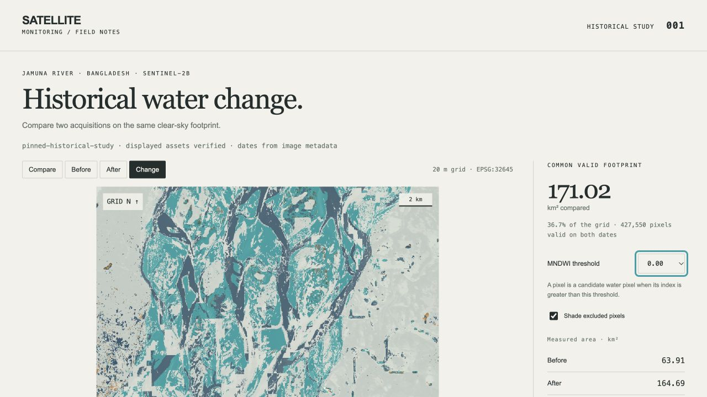

# Verification record — 27 October 2026

The following checks were run locally on macOS with Python 3.12.14, NumPy 2.3.5, Rasterio 1.4.4 / GDAL 3.10.3, and Pillow 12.3.0. Exact dependencies are in `requirements-benchmark.txt`. CI repeats the checks on Linux, macOS, and Windows with Python 3.12 and 3.13; use the pull request's actual check results for CI status.

## Behavior and calculations

- `python -m pytest --cov=satellite_monitoring --cov-branch --cov-report=term-missing --cov-fail-under=85`: **25 passed**, **86.08% combined line/branch coverage**. Fixtures test exact range reads and changed ETags, request/byte/time bounds, cached reads, synthetic source COG acquisition, derived-array pin failure, DN resampling, geographic/non-metre rejection, alignment/non-overlap, nodata/cloud intersection, strict thresholds, counts/areas, invalid inputs, reverse dates, exports, no overwrite, metadata-only scaling tampering, positive-offset nodata, CLI errors, Host rejection, read-only routes, and real symlink rejection. The symlink-creation fixture is skipped on Windows, where that operation requires developer privileges; the other server checks still run there.
- The suite reports 22 `PendingDeprecationWarning` messages from Rasterio's use of an Affine operator. These do not change the measured result. They are retained, not suppressed.
- `node --test tests/viewer.test.mjs tests/recorded-study.test.mjs`: **4 passed**. The browser classification module reproduces the recorded real study at all five presets, including float32 threshold equality, non-finite exclusions, class meanings, and common-footprint counts. The real-study test also checks compressed index hashes.
- Ruff lint and format checks pass for `src`, `tests`, and `tools`. Git whitespace checks pass.

## Real data and provenance

The fresh strict acquisition completed using only the fixed public provider assets. It transferred **27,000,832 bytes in 77 requests over 322.596 seconds**, within the 64 MB / 256 request / 600-second budget. Download time is not deterministic. Both derived array hashes and complete cropped TIFF hashes match the bundled study. Metadata, source ETags/sizes, exact range digests, and the grid are recorded in `resources/study/acquisition.json` and `resources/source-pins.json`.

The refreshed `demo/metrics.json` records current Python-source SHA256:

`039e31029986e509dfbff5a42511f5ab71cd50c4ee5a277cf5f57cce3861a33d`

The digest was independently recomputed from sorted package Python module filenames and contents and matched the report. Both effective reflectance scales are 0.0001 and both offsets are 0. The default output has **427,550 common-valid pixels**, **259,207 candidate-gain pixels**, and **7,262 candidate-loss pixels**. These measurements are not flood ground truth.

Initial Windows CI correctly rejected changed pinned metadata bytes: Git's automatic CRLF checkout changed the original JSON line endings. Repository attributes now keep text in LF form and leave TIFF, PNG, and gzip files binary. A separate checkout with `core.autocrlf=true` verified the exact metadata and source digests. The checksum validation remains strict; no algorithm or data pin was changed.

## Package integration

`python -m build --no-isolation` builds a source distribution and wheel. `python tools/check_wheel.py dist/*.whl` then installs the wheel with no index or dependency resolution into a fresh temporary target. A subprocess starts outside the source tree, asserts the imported package resolves inside that target, and runs:

1. The complete bundled historical demo while external connection creation is blocked.
2. Explicit analysis of the installed package's two real crops, with identical measurements.
3. A loopback preview serving HTML, JavaScript, the gzip indices, and the classification GeoTIFF.
4. CLI version output.

All passed. The wheel includes the two small crops, acquisition record, pinned metadata, source pins, and viewer files. Its uncompressed contents are below 20 MB; full source scenes, temporary environments, caches, and native dependency wheels are absent. The source distribution also includes tests, development notes, and actual demo results. The package is not claimed to be published to PyPI.

## Browser checks

The refreshed report loaded in the in-app browser from the reviewed loopback server. The pinned-study label, verified displayed assets, true image dates, 20 m EPSG:32645 grid, grid north, 2 km scale, 171.02 km² common footprint, and 36.7% coverage were visible. Compare, Before, After, and Change modes worked. The comparison divider and excluded-pixel shading responded. Selecting threshold 0.30 changed the table to before 42.44, after 132.21, gain 98.37, and loss 8.60 km², then returning to 0.00 restored the recorded values. The GeoTIFF download explicitly stays labeled threshold 0.00.

This screenshot shows actual processed data. The README line-art cover is a separate generated concept. Responsive styles are included; a specific mobile viewport has not been independently exercised in this local record. No field comparison, ground-truth flood-accuracy evaluation, live-provider operation, or operational acceptance test has been performed.

## History and review

The old repository's main commit `fde2271e5c1ef8bf022a465d1a562aba74b3c2e6` was archived remotely before replacement. The repository ID `R_kgDOLKP_ug` and 20 stars were checked after the approved rename. The old MIT notice is preserved. Publication uses a new feature branch and pull request, with independent review and passing CI required before merge. The portfolio source is unchanged.
